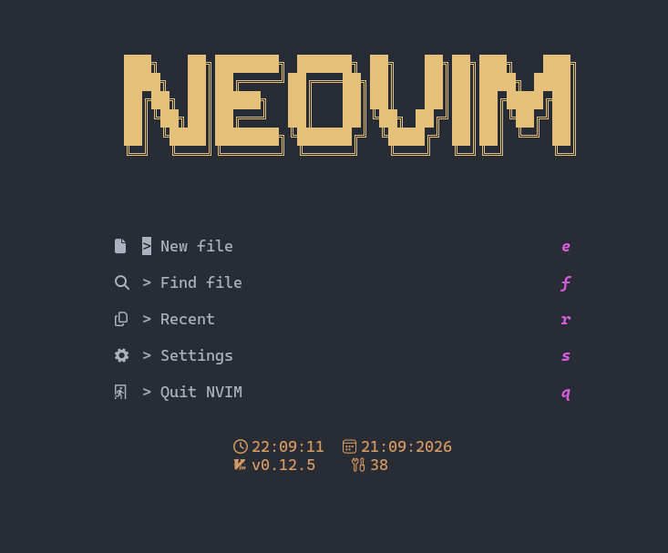
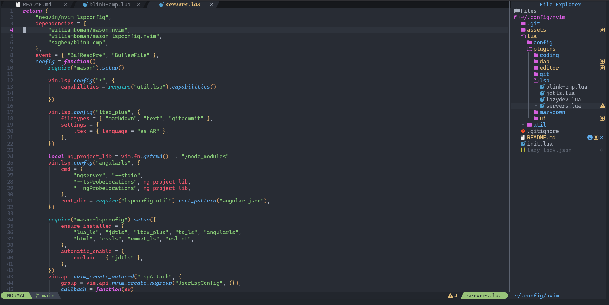

# Neovim Configuration (v0.11+)

Configuración personal de Neovim v0.11.5, construida desde cero e integrada con:

* **lazy.nvim** (gestor de plugins)
* **LSP** (nvim-lspconfig + Mason)
* **blink.cmp** (autocompletado)
* **Treesitter** (resaltado sintáctico)
* **OneDarkPro** (tema) con UI moderna
* **snacks.nvim** (dashboard, picker, terminal, imágenes)
* **noice.nvim** (mensajes y notificaciones mejorados)
* **Copilot** (sugerencias con IA)
* **nvim-dap** (debugging)
* **Conform** (formateo bajo demanda)
* **gitsigns / diffview** (integración con Git)
* Atajos personalizados optimizados

---

## Capturas





## Requisitos previos

### Nerd Font

Descargar desde [https://www.nerdfonts.com/](https://www.nerdfonts.com/)

### Dependencias recomendadas

| Herramienta | Uso |
|-------------|-----|
| ripgrep | Búsquedas rápidas (Snacks picker) |
| fd | Búsqueda de archivos |
| Node.js | Algunos LSPs |
| JDK 25+ (JRE o JDK) | Ejecutar jdtls (ver sección Java) |

### Renderizado de imágenes (snacks.nvim)

El renderizado de imágenes (markdown, etc.) lo maneja `snacks.nvim`, que usa el protocolo gráfico de la terminal (kitty/sixel/iTerm) sin necesidad de dependencias de sistema adicionales.

---

## Instalación

### Windows

```powershell
git clone https://github.com/GCrel/nvim $env:LocalAppData/nvim
nvim
```

Luego ejecutar: `:Lazy sync`

### Linux / macOS

```bash
git clone https://github.com/GCrel/nvim ~/.config/nvim
nvim
```

Luego ejecutar: `:Lazy sync`

---

## Estructura del proyecto

```
nvim/
├── init.lua
├── lazy-lock.json
├── lua
│   ├── config
│   │   ├── commands.lua
│   │   ├── keymaps.lua
│   │   ├── lazy.lua
│   │   ├── lsp.lua
│   │   └── options.lua
│   ├── util
│   │   ├── java.lua
│   │   └── lsp.lua
│   └── plugins
│       ├── coding
│       │   ├── autopairs.lua
│       │   ├── comment.lua
│       │   ├── conform.lua
│       │   └── copilot.lua
│       ├── dap
│       │   └── dap.lua
│       ├── editor
│       │   ├── neo-tree.lua
│       │   └── treesitter.lua
│       ├── git
│       │   ├── diffview.lua
│       │   └── gitsigns.lua
│       ├── lsp
│       │   ├── blink-cmp.lua
│       │   ├── jdtls.lua
│       │   ├── lazydev.lua
│       │   └── servers.lua
│       ├── markdown
│       │   └── markdown.lua
│       └── ui
│           ├── bufferline.lua
│           ├── lualine.lua
│           ├── noice.lua
│           ├── snacks.lua
│           └── theme.lua
└── README.md
```

## Plugins incluidos

| Plugin | Función |
|--------|---------|
| lazy.nvim | Gestor de plugins |
| snacks.nvim | Dashboard, picker, terminal, imágenes, indent, lazygit, scratch, scroll |
| nvim-autopairs | Autocierre de pares |
| bufferline.nvim | Línea de buffers |
| onedarkpro.nvim (onedark_vivid) | Tema |
| Comment.nvim | Comentarios |
| blink.cmp | Autocompletado (LSP, buffer, snippets, path) |
| conform.nvim | Formateo manual con `<leader>fm` (prettier: TS/HTML/SCSS/CSS); no formatea al guardar |
| mason-tool-installer.nvim | Instala herramientas extra automáticamente |
| copilot.lua | Sugerencias con IA |
| nvim-dap + dap-ui | Debugging |
| diffview.nvim | Vista de diffs de Git |
| gitsigns.nvim | Marcadores de Git en la línea |
| noice.nvim | UI de mensajes, notificaciones y LSP |
| lazydev.nvim | Soporte de librerías para Lua |
| nvim-jdtls | LSP de Java |
| lualine.nvim | Barra de estado |
| render-markdown.nvim | Renderizado de Markdown |
| neo-tree + nvim-file-operations | Explorador de archivos (rename vía LSP; jdtls solo anuncia `willRename`, no trata mover como refactor) |
| nvim-treesitter | Resaltado e indentación |

---

## LSP incluido

| LSP | Lenguaje |
|-----|----------|
| lua_ls | Lua |
| jdtls | Java |
| ltex_plus | Español (ortografía/gramática, es-AR) en markdown/text/gitcommit |
| ts_ls | TypeScript / JavaScript |
| angularls | Angular |
| html | HTML |
| cssls | CSS |
| emmet_ls | Emmet (HTML/CSS) |
| eslint | ESLint (JS/TS) |

Para instalar más: `:Mason`

`mason-tool-installer` asegura automáticamente herramientas extra al iniciar: `prettier`, `java-debug-adapter` y `java-test`.

El LSP de Angular (`angularls`) se configura automáticamente buscando los `ngserver` en el `node_modules` del proyecto y tomando `angular.json` como raíz.

El LSP de Java (jdtls) se configura automáticamente con:
* Soporte para Maven, Gradle y `.git` como directorios raíz del proyecto
* Lombok integrado (javaagent)
* Debugging remoto (java-debug-adapter) y tests (java-test) instalados vía Mason
* Organización de imports, extracción de variables/constantes y ejecución de tests

#### Versión de Java

jdtls (>= 1.62) necesita Java 25+ para **ejecutarse**, pero el proyecto puede usar cualquier versión. `lua/util/java.lua` los separa:

* Ejecuta jdtls con el Java más nuevo que encuentre.
* Registra como runtimes del proyecto todos los JDK (con `javac`) encontrados; jdtls elige el que pida el `pom.xml`/`build.gradle`. Un JRE sirve para ejecutar jdtls pero no para compilar.
* Si el más nuevo es menor que 25, avisa con una notificación.

Busca en: sdkman, asdf, mise, jenv, `/usr/lib/jvm`, JDKs de macOS (`/Library/Java/JavaVirtualMachines`, Homebrew), `JAVA_HOME` y el `java` del `PATH`. Para otras ubicaciones:

```bash
export JDTLS_JAVA_DIRS="/opt/mis-jdks:/otra/ruta"   # cada entrada: un JDK o una carpeta con JDKs
```

Los JDK en Windows no se detectan automáticamente.

---

## Keybindings completos

### Buffer Control

| Atajo | Acción |
|-------|--------|
| `<Tab>` | Siguiente buffer |
| `<S-Tab>` | Buffer anterior |
| `<leader>bc` | Cerrar buffer actual |
| `<leader>bs` | Guardar y cerrar buffer |

### Portapapeles

| Atajo | Acción |
|-------|--------|
| `cp` | Copiar (normal/visual) |
| `cv` | Pegar (normal/visual) |
| `x` | Borrar sin copiar |
| `<leader>a` | Seleccionar todo |

### Operaciones de línea

| Atajo | Acción |
|-------|--------|
| `<leader>d` | Duplicar línea |
| `<C-j>` | Mover línea/selección abajo |
| `<C-k>` | Mover línea/selección arriba |

### Selección

| Atajo | Acción |
|-------|--------|
| `<leader>s` | Seleccionar hasta fin de línea |
| `<leader>sl` | Seleccionar línea completa |

### Búsqueda y Navegación

| Atajo | Acción |
|-------|--------|
| `<leader>f` | Buscar en archivos (grep) |
| `<leader>p` | Buscar archivos |
| `<leader>o` | Archivos recientes |
| `<leader>b` | Buscar buffers |
| `<C-n>` | Toggle Neo-tree |
| `<leader>e` | Focus Neo-tree |

### Git

| Atajo | Acción |
|-------|--------|
| `<leader>gd` | Ver diffs de Git |
| `<leader>gg` | Abrir Lazygit |
| `<leader>gb` | Abrir en GitHub (Git Browse) |

### Comentarios

| Atajo | Acción |
|-------|--------|
| `<C-/>` | Comentar línea (normal) |
| `<C-/>` | Comentar selección (visual) |

### Terminal (snacks.nvim)

| Atajo | Acción |
|-------|--------|
| `<leader>th` | Terminal horizontal |
| `<leader>tf` | Terminal flotante |

### Scratch

| Atajo | Acción |
|-------|--------|
| `<leader>.` | Toggle buffer scratch |

### LSP - Navegación

| Atajo | Acción |
|-------|--------|
| `gd` | Ir a definición (picker) |
| `gD` | Ir a declaración |
| `gi` | Ir a implementación (picker) |
| `gr` | Ver referencias (picker) |
| `K` | Mostrar hover |
| `<leader>ss` | Buscar símbolos del documento (picker) |

### LSP - Edición

| Atajo | Acción |
|-------|--------|
| `<leader>rr` | Rename símbolo |
| `<space>ca` | Code Actions |
| `<leader>fm` | Formatear documento (conform) |

### LSP - Diagnósticos

| Atajo | Acción |
|-------|--------|
| `<leader>en` | Siguiente error |
| `<leader>ep` | Error anterior |
| `<leader>eq` | Mostrar lista de errores |

### Autocompletado (Insert Mode) — blink.cmp

| Atajo | Acción |
|-------|--------|
| `<Tab>` | Siguiente sugerencia / expandir snippet |
| `<S-Tab>` | Anterior sugerencia / retroceder snippet |
| `<C-Space>` | Mostrar sugerencias |
| `<C-k>` | Scroll documentación arriba |
| `<C-l>` | Scroll documentación abajo |
| `<C-e>` | Ocultar menú |
| `<CR>` | Aceptar selección |

Fuentes: `lsp`, `path`, `snippets` (LuaSnip + friendly-snippets), `buffer`.

### Copilot (Insert Mode)

| Atajo | Acción |
|-------|--------|
| `<C-y>` | Aceptar sugerencia |
| `<Alt-]>` | Siguiente sugerencia |
| `<Alt-[>` | Sugerencia anterior |
| `<C-\>` | Descartar sugerencia |

### Debugging (DAP)

| Atajo | Acción |
|-------|--------|
| `<F5>` | Iniciar / continuar debug |
| `<F10>` | Step over |
| `<F11>` | Step into |
| `<F12>` | Step out |
| `<leader>tb` | Toggle breakpoint |

### Java (jdtls)

| Atajo | Acción |
|-------|--------|
| `<leader>jo` | Organizar imports |
| `<leader>jv` | Extraer variable |
| `<leader>jc` | Extraer constante |
| `<leader>tc` | Ejecutar test de la clase |
| `<leader>tm` | Ejecutar test más cercano |
| `:FormatProject` | Formatea todos los `.java` bajo `src/` con conform (definido en `config/commands.lua`) |

### Treesitter (Visual Mode)

| Atajo | Acción |
|-------|--------|
| `<C-space>` | Iniciar / expandir selección incremental |
| `<bs>` | Reducir selección |

---
